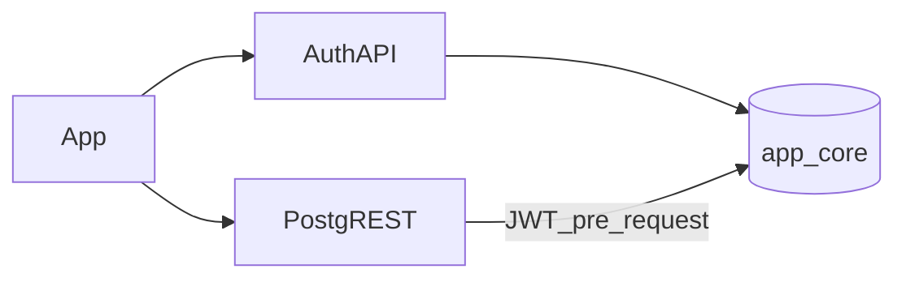

# 사내 PostgreSQL 도메인 SoT 런북

인증·테넌트·Capability 테이블의 Source of Truth를 사내 PostgreSQL(`app`/`core`)로 둔다.  
브라우저는 **Auth API** + **PostgREST**만 호출한다(PG 직접 접속 금지).

## 구성

| 구성 | 역할 |
|------|------|
| PostgreSQL | `app`(users/sessions), `core`(org·업무 테이블·RPC) |
| Auth API | `npm run auth:serve` — 로그인·JWT·멤버십·직급 API |
| PostgREST | `:3001` — Refine/`getCoreClient()` 호환 REST |
| 마이그레이션 | `migrations/domain/*.sql` → `npm run db:migrate:domain` |



## 필수 전제

- **Postgres + PostgREST가 떠 있어야** 도메인 SoT를 통과로 본다.
- **PGlite는 Auth 단위/오프라인 폴백만** — `test:domain-smoke`는 PostgREST 없으면 **실패**한다.
- Docker 없는 환경에서 “도메인 통과”를 주장하지 않는다.

## 로컬 기동

```bash
npm run db:up:stack                 # postgres + postgrest
npm run db:wait
npm run db:migrate:domain:strict    # EP_MIGRATE_STRICT=1
npm run db:seed                     # *@ep.local 개발 시드
npm run auth:serve                  # :8787
# .env: VITE_LOCAL_AUTH=true VITE_CORP_DOMAIN=true VITE_SUPABASE_URL=http://127.0.0.1:3001
npm run dev
```

검증:

```bash
npm run test:local-auth-staging
npm run test:domain-smoke           # PostgREST 필수
```

## 슬라이스·컷오버

마이그레이션에 이미 포함된 테이블/RPC:

1. Canary: meal_survey, volunteer, office_supply_*, anonymous_grievances  
2. approval_requests / process_approval_step_atomic  
3. mbo_objectives / revise_mbo_goal  
4. inventory_items, supply_restock_items  

컷오버 체크리스트(슬라이스마다):

1. `db:migrate:domain` 적용  
2. owner JWT로 PostgREST select/insert 1건  
3. 관련 UI 스모크  
4. 실패 시 PostgREST URL을 내리고 `VITE_CORP_DOMAIN=false`로 셸만 유지(업무 데이터 없음)

## 사내 배포

1. `DATABASE_URL`에 corp PG (`sslmode=require`)  
2. `EP_LOCAL_AUTH_SEED_MODE=none` 후 `npm run seed:corp-bootstrap`  
3. Auth API + PostgREST(동일 JWT secret `EP_JWT_SECRET`)  
4. 프론트: `VITE_LOCAL_AUTH=true`, `VITE_CORP_DOMAIN=true`, `VITE_SUPABASE_URL=<postgrest>`, `VITE_AUTH_API_BASE=<auth>`

## 롤백

1. PostgREST/Auth 트래픽 차단  
2. DB는 forward-only → 스키마 롤백은 백업 복원  
3. `VITE_CORP_DOMAIN=false`로 빈 캐시 셸 복귀(임시)

## 백업

1. **UI:** 조직 설정 카드 `OrganizationBackupCard` — 테넌트 스냅샷 내보내기  
2. **DB (권장 운영):**

```bash
# 예시 — 호스트/포트·자격은 사내 표준에 맞게 교체
pg_dump --format=custom --file=ep_local_$(date +%Y%m%d).dump \
  "$DATABASE_URL"
```

복원: `pg_restore --clean --if-exists -d "$DATABASE_URL" ep_local_YYYYMMDD.dump`  
앱 백업과 DB 덤프를 함께 보관한다. 상세 운영 항목은 [EP_OPS_CHECKLIST.md](./EP_OPS_CHECKLIST.md).

## 관련 문서

- 인증 전용: [EP_CORP_PG_AUTH_RUNBOOK.md](./EP_CORP_PG_AUTH_RUNBOOK.md)  
- 캐시 경계: [EP_DATA_CACHE_BOUNDARY.md](./EP_DATA_CACHE_BOUNDARY.md)  
- 파일럿 수용: [EP_PILOT_ACCEPTANCE.md](./EP_PILOT_ACCEPTANCE.md)  
- 운영 체크리스트: [EP_OPS_CHECKLIST.md](./EP_OPS_CHECKLIST.md)
